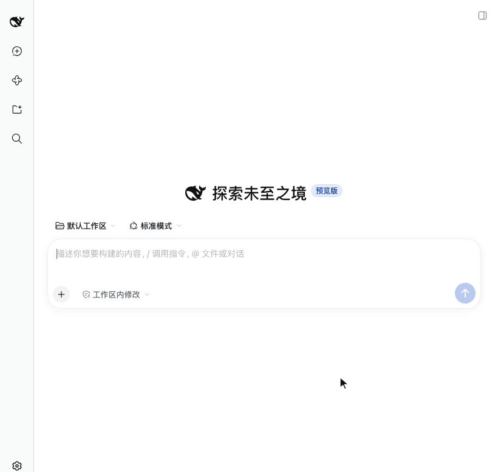

<div align="center">

# dsh-intelligent-ui

**[DeepSeek Harness](https://github.com/deepseek-ai/deepseek-harness) 的 Web 插件：模型不再只用文字回答，而是直接给出一个可以操作的界面。**

[](package.json)
[](https://www.npmjs.com/package/@left0ver/dsh-intelligent-ui)
[](LICENSE)

[English](README.md) · 简体中文

</div>



## 功能

- **边生成边显示**：模型每写出一段，界面就多出一块。
- **本地交互**：拖动滑块、修改输入、切换页签后立即重算，不再请求模型。
- **常用控件**：滑块、输入框、下拉选择、勾选框、页签、按钮、表格、折线图和柱状图。
- **隔离运行**：模型写的程序在沙箱里运行，不能联网，也读不到页面上的数据。

## 快速开始

### 1. 安装

```sh
dsh plugin --profile web add @left0ver/dsh-intelligent-ui
```

新版本刚发布时可能被 pnpm 的冷静期拦住。在 `~/.dsh/profiles/web/pnpm-workspace.yaml` 里加上下面两行再安装：

```yaml
minimumReleaseAgeExclude:
  - '@left0ver/dsh-intelligent-ui'
```

### 2. 启动

```sh
dsh web
```

### 3. 提问

像平时一样提需求，不用提到插件。例如：

```
用图表对比每月定投和一次性投入，在不同年化收益率下 20 年的资产变化
```

## 更新与卸载

```sh
dsh plugin --profile web update @left0ver/dsh-intelligent-ui
dsh plugin --profile web remove @left0ver/dsh-intelligent-ui
```

## 已知限制

- 界面状态不保存，刷新页面后回到初始值。
- 模型看不到你在界面上的操作，追问时它不知道滑块被拖到了哪里。

## 致谢

感谢 [Disdjj/intelligent-ui-demo](https://github.com/Disdjj/intelligent-ui-demo) 提供的 OpenAI 实现 Intelligent UI 的思路，本插件基于这些思路实现。

## 许可证

[MIT](LICENSE)
